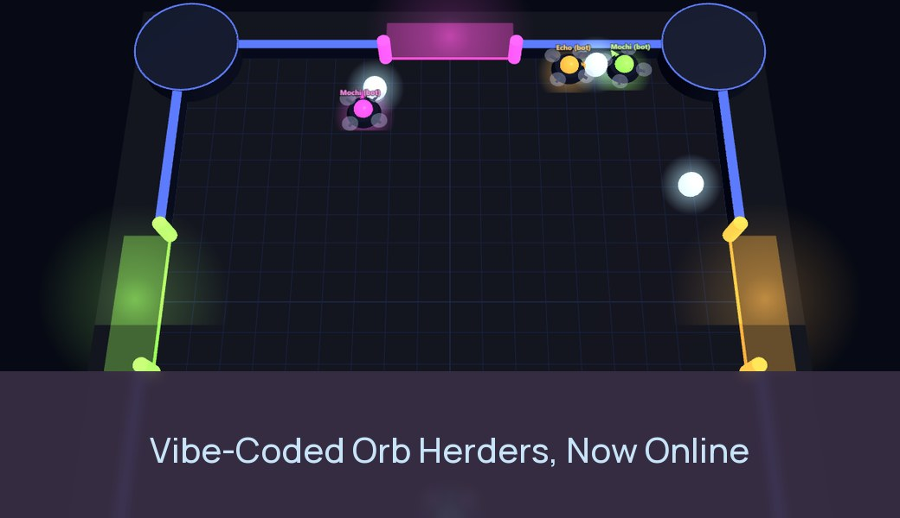

# Orb Herders: a vibe-coded game made online multiplayer on Edgegap



Orb Herders is a small Three.js browser game: hover drones push glowing orbs into their own goal and dash into each other to knock rivals away. It was first built as a single-player game against bots, the way a vibe coder would build it. Then an AI agent (Claude Code) with the Edgegap MCP server connected turned it into online multiplayer: each match runs on its own authoritative server, placed near its players, started by the Edgegap matchmaker and stopped when the match ends. Every line in this repo was written by the agent; the prompts are in [PROMPTS.md](PROMPTS.md).

**Play:** https://edgegap.github.io/netcode-sample-threejs-vibe-coded/ (Find Match for online, or Play vs bots). Works on phones and desktops.

## Before and after

- [`before`](https://github.com/edgegap/netcode-sample-threejs-vibe-coded/tree/before): the single-player game. Plain HTML and JS, Three.js from a CDN, no build step.
- [`after`](https://github.com/edgegap/netcode-sample-threejs-vibe-coded/tree/after): the same game with online matches on Edgegap. Solo play still works.
- [The diff](https://github.com/edgegap/netcode-sample-threejs-vibe-coded/compare/before...after): what it took to go online.

The game rules (`client/arena.js`) did not change. In the `after` version the server runs that same file and owns the match: players only send inputs, and the page draws what the server sends back.

## Do this with your own game

1. Connect the Edgegap MCP server to your agent (Claude Code, Codex, Cursor, ChatGPT...): `https://mcp.edgegap.dev/mcp`, or locally with `npx @edgegap/mcp`. It needs an Edgegap API token, which stays in the agent's settings and never goes into your game.
2. Open your game's folder and give the agent one prompt, for example:

   > Make this game online multiplayer on Edgegap. Use the Edgegap MCP and its edgegap-threejs skill. Keep the solo mode, add a Find Match button. Ask me before you create anything in my Edgegap account.

The agent loads the [`edgegap-threejs`](https://github.com/edgegap/llm-agent-skills) skill through the MCP and follows it: a Node.js server per match, Find Match with the Edgegap JS SDK, a Dockerfile, a matchmaker config and tests. You do the account steps it can't: logging in to the container registry, adding the registry login to the app version and creating the matchmaker in the dashboard.

The skill is written for Three.js and other browser games with their own WebSocket server (Babylon.js, PlayCanvas, Phaser, plain canvas). The MCP has skills for other engines too: Unity, Unreal, Godot, Colyseus and more.

## How it works

```
page --Find Match (Edgegap JS SDK)--> Edgegap matchmaker
                                         | groups 2-4 players (a lone player after 20 s, with bots)
                                         v
                                    one game server near those players
page <--wss://<id>.pr.edgegap.net:<port>-- game server: 60 Hz simulation, 20 Hz snapshots
                                         | match over (or nobody joins, or everyone leaves)
                                         v
                                    server stops its own deployment: billing stops
```

- **Matchmaker** (`matchmaker/arena.json`): one profile, `arena`, 2 to 4 players. Edgegap starts the server near the matched players.
- **Server** (`server/`): one Node.js process per match. It reads Edgegap's injected variables, listens on port 7777 on `0.0.0.0`, fills empty seats with bots, plays a 3-minute match (or first to 15) and then calls Edgegap's self-stop URL. It also stops if nobody joins within 2 minutes or everyone leaves for 30 seconds, and exits cleanly on SIGTERM.
- **Client** (`client/`): a static page on GitHub Pages. It only talks to the matchmaker (with the matchmaker's client token, made to ship in games) and to its match's server. The Edgegap API token is never in the page.
- **Port**: WebSocket with TLS Upgrade, so a page on `https` connects with `wss://`; the page retries the first connection while a fresh server boots.

## Run it locally

Needs Node.js 22 and, for the container tests, Docker.

```bash
npm ci
```

```bash
node server/main.js
```

```bash
npx http-server client -p 8080
```

Open http://localhost:8080 in two tabs and click **Local server :7777** in both (that button only shows on localhost). Off Edgegap the server never stops; matches loop.

Tests:

```bash
node tests/local-match.mjs
```

```bash
bash tests/parity.sh
```

```bash
MM_URL=https://<matchmaker>.edgegap.net MM_TOKEN=<matchmaker auth token> node tests/e2e.mjs arena 2
```

- `local-match.mjs`: two headless players play a full match on a local server.
- `parity.sh`: the server image run the way Edgegap runs it (injected variables, a random outside port, two servers on one host, SIGTERM, self-stop).
- `e2e.mjs`: two headless players go through the real matchmaker, play a whole match on Edgegap and check the server stopped itself.

## Ship a new server build

Pushing to `main` builds the image and pushes it to the Edgegap Container Registry with a UTC timestamp tag (`.github/workflows/server-image.yml`; secrets `EDGEGAP_REGISTRY_USERNAME`, `EDGEGAP_REGISTRY_TOKEN`, variable `EDGEGAP_REGISTRY_PROJECT`). Point the app version at the new tag (dashboard, the MCP's `edgegap_update_app_version`, or [edgegap/deploy-action](https://github.com/edgegap/deploy-action)); running matches keep the old build. Changes under `client/` publish to GitHub Pages (`.github/workflows/pages.yml`).

## License

MIT
